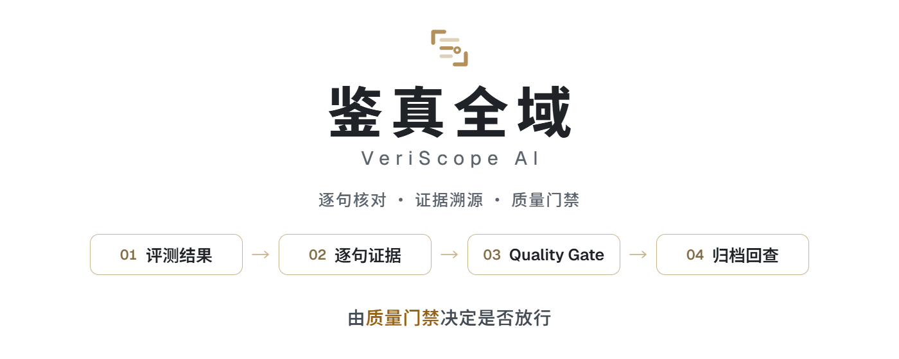
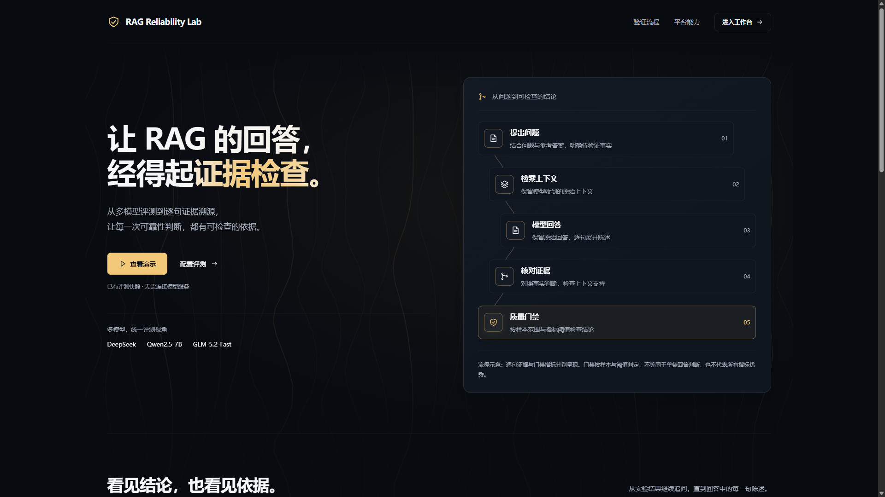
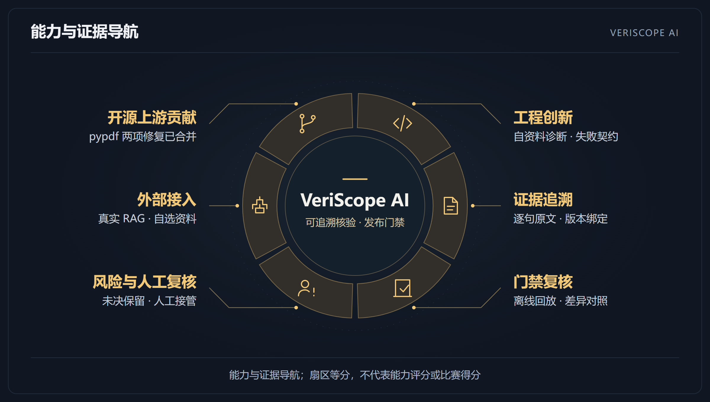
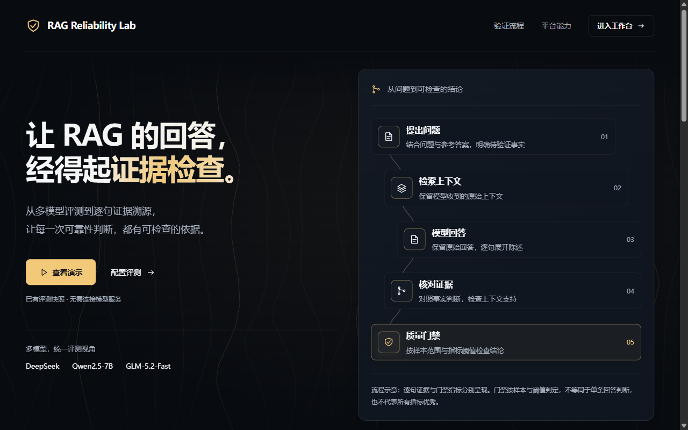
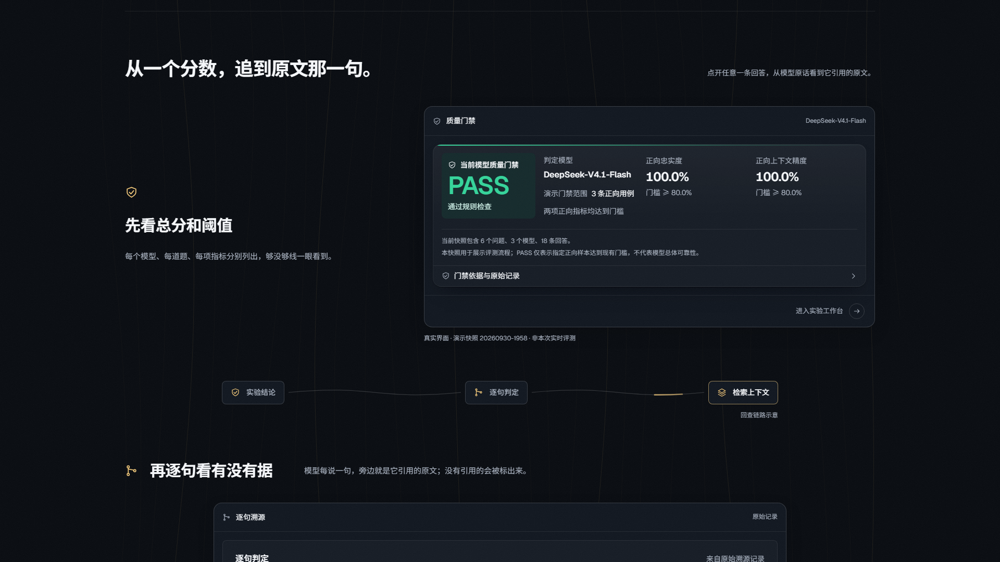
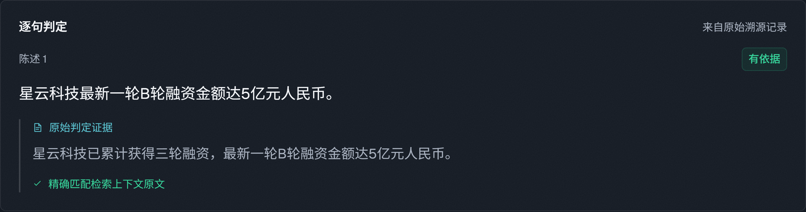

<a href="https://kk444444444444.cloud/">
  <picture>
    <source media="(prefers-color-scheme: dark)" srcset="docs/images/readme-banner-dark.gif">
    
  </picture>
</a>

<a href="CHANGELOG.md"></a> <a href="#快速启动"></a> <a href="LICENSE"></a> <a href="https://github.com/4444wjt/RAG_Evaluation_Demo/actions/workflows/ci.yml"></a> <a href="https://github.com/4444wjt/RAG_Evaluation_Demo/actions/workflows/codeql.yml"></a>

[简体中文](README.md) · [English](README.en.md)

# 鉴真全域 VeriScope AI

**RAG 回答的逐句核对与质量门禁平台。** 把回答拆成逐句、每句对回检索原文，再由门禁按阈值判定这批回答能否放行——错在哪句、修完有没有变好、凭什么放行，都能回查。归档结果可离线复算，不调用模型、也不需要密钥。

**▶ 在线演示**：[kk444444444444.cloud](https://kk444444444444.cloud/)（免登录、不调用模型，打开就是一次真实 FAIL 的门禁结论 + 逐句证据 + 换裁判对比） · **一键起站**：[Docker 三行](#快速启动) · **全部文档**：[docs/](docs/README.md)

代码仓库：[Gitee（主）](https://gitee.com/kkbushishou/rag-hallucination-evaluator) · [GitHub（镜像，运行 CI 与 Pages 备用站）](https://github.com/4444wjt/RAG_Evaluation_Demo)

## 项目价值与对照验证

面向中文 RAG 上线前的质量验证：查清哪句话有问题、修复是否有效、版本放行依据是什么。

- **证据可回查**：逐句判定与检索原文并列展示，便于定位问题和人工复核。[查看演示](docs/demo/README.md)
- **修复可对照**：先逐题归因，再比较改前改后。[同一次 FAIL 的三种看法](docs/competition/value-comparison.md) · [修复验证](docs/competition/evidence/20261014T073859Z-full-1c6f091f/README.md)
  - 例：《存款保险条例》节选 25 题，只看 Ragas 总分 0.59 看不出低在哪；逐题归因指向 4 道错误前提题被模型拒答（所需法条已检索到），已检索到的原文提供了具体修复入口：在回答提示中要求指出并纠正错误前提。
  - 加入纠正指引后的跨版本重跑中，这 4 道纠正 3 道、1 道仍拒答；该对照不是单因素实验。另用两组只差这一句提示的 24 道新题验证，错误前提题的纠正由 9/14 升到 14/14（单模型、每组单次运行，未换裁判复核）。
- **结论可复核**：门禁裁决可用归档结果离线重放，不调用模型、不需要密钥；指定上一次运行（`--baseline`）后逐题对比，只拦确定退步，波动范围内的下降只提示。机器结论与人工核验分开保存。[门禁回放](docs/gate-replay.md) · [人工核验范围](docs/evaluation-credibility.md#3-人工核验范围与录入规则)

**把对照方做强，再比较**：法条结构核对（按法规原文逐句核对回答所引条款、数额期限和情态词）是独立诊断，不参与门禁。它不只和原提示下的通用裁判比，还与加强提示后的裁判、拿到相同节选的裁判和词面最近邻基线比较，并换一部法规的 AI 改写材料再比；检出、误报和定位错误一并报告，用来判断哪种核查方法够用。

<details>
<summary>展开查看四项对照的归档结果</summary>

前三行用同一批 66 条款项定位材料（《存款保险条例》节选，受控注入，含 31 条款级错误、31 条支持对照）；规则在这批材料上款级检出 30/31、支持对照误报 0/31。第四行换用《政府信息公开条例》节选，T2 为 AI 改写层（40 条错误、32 条对照）。四行条件不同，应分别阅读，不是一次联合验证。

| 对照怎么加强 | 已归档结果 | 对使用者的意义 |
|---|---|---|
| [强化裁判提示](docs/competition/statute-check/20261021-pinpoint-run/README.md) | DeepSeek 款级错误检出 1/31 → 22/31，支持对照误报 2/31 → 7/31；Qwen2.5-72B 两种提示下检出均为 1/31、误报均为 2/31 | 同时查看检出收益与误报代价 |
| [给裁判相同的完整节选](docs/competition/statute-check/20261022-equalinfo/README.md) | 原提示下换上完整节选：DeepSeek 检出 1/31 → 3/31，Qwen2.5-72B 仍为 1/31 | 补齐资料后仍有明显差距，资料不对等不足以解释全部差距 |
| [加入词面最近邻基线](docs/competition/statute-check/20261022-lexical-baseline/README.md) | 款级错误：规则 30/31、词面基线 31/31；两者支持对照误报均为 0/31 | 识别简单方法已能完成的检查 |
| [在改写材料上再比较](docs/competition/statute-check/20261023-stage3-baselines/README.md) | T2：规则检出 27/40、误报 0/32；词面基线检出 39/40、误报 1/32，其中 1 条检出正确但回指位置错误 | 12 条差距中 9 条源于规则未比较同款各项内容；检出不等于正确定位 |

以上为受控注入或改写材料上的归档结果，不代表总体准确率或规则优于强基线；门禁判定范围见[评测可信度与限制](docs/evaluation-credibility.md)。

</details>

鉴真全域 VeriScope AI 面向 RAG 问答应用：把模型回答拆成逐句，每一句对照检索原文核对是否有依据，再由质量门禁（Quality Gate）按阈值决定这批回答能否放行。题集、检索上下文、多模型回答、Ragas 指标、逐句判定、门禁记录和人工核验保存在同一条链路上，「回答是否可信」可以按「题集 → 逐句核对 → 门禁 → 报告 → 人工核验」逐条回查。

**典型用法：RAG 应用上线前，把它接进 CI 当回归门禁——门禁不通过，构建失败。** 已归档的评测结果可离线重放门禁裁决，不调用模型、不需要密钥，不通过时以非零退出码结束。门禁已打包为 GitHub Action（[action.yml](action.yml)，Action 托管在 GitHub 镜像），其他仓库加一步 `uses: 4444wjt/RAG_Evaluation_Demo@master` 即可接入，CI 页面会显示哪个指标没过、差多少（作业摘要与 JUnit 报告）。指定基线（`--baseline` / `baseline`）后还会逐题对比上一次运行，区分「确定退步」和「在题目抽样与裁判波动范围内的下降」，只有前者拦截；接入示例见 [quality-gate-example.yml](.github/workflows/quality-gate-example.yml)，用法见 [门禁回放](docs/gate-replay.md)。

项目采用 React 展示首页与仪表盘、FastAPI 本地接口及既有 Python 评测引擎；CLI 和 Gradio 入口继续保留。支持无密钥演示快照与配置后的真实评测。

**裁判与外部应用接入：** 评测工作区、API 和 CLI 支持[单独配置裁判](docs/integrations/independent-judge.md)，回答生成与五项指标／Trace 核对可使用不同模型，并记录裁判请求名和实际响应名。[外部 RAG 端到端接入](docs/integrations/external-rag.md)只发送题号与问题，由应用返回回答和实际生成资料，结果独立归档。两项已于 2026-10-14 各真实运行一次（经授权）：[换独立裁判重跑 25 题](docs/competition/evidence/20261014T125415Z-full-a5002d4f/README.md)、[自写示例应用的端到端实测](docs/competition/external-rag/20261014-example-app-qwen72b/README.md)，门禁都是 FAIL，见下文「换独立裁判后」。历史实验不回填。2026-10-22 又用银行公开的存款保险问答 11 题测了 AnythingLLM 源码构建实例：门禁 PASS，但 6 道负向题全部给出了节选外的内容，说明只看正向题的门禁拦不住不拒答的应用，见 [银行问答实测](docs/competition/external-rag/20261022-bank-qa-anythingllm/README.md)。

[作品介绍](docs/competition/project-introduction.md) · [同一次 FAIL 的三种看法](docs/competition/value-comparison.md) · [快速启动](#快速启动) · [评测可信度与限制](docs/evaluation-credibility.md) · [全部文档](#全部文档)



## 快速启动

**一键起站（Docker，Windows / macOS / Linux 同一套命令）。** 需要 Docker Desktop，或 Docker Engine + Compose v2.24 以上。三行跑完，默认只监听本机：

```bash
git clone https://gitee.com/kkbushishou/rag-hallucination-evaluator.git
cd rag-hallucination-evaluator/deploy
cp .env.example .env && docker compose up -d --build
```

打开 `http://127.0.0.1:8080/` 就是只读演示站，与公网演示同一个入口：只能看快照，不能发起在线评测。Linux 与 macOS 也可以直接跑 `./deploy.sh`（多一步健康检查轮询）。首次构建要拉镜像、装依赖，需要几分钟；完整选项见 [部署说明](deploy/README.md)。

不想装 Docker、只想在浏览器里看：[GitHub Pages 备用站](https://4444wjt.github.io/RAG_Evaluation_Demo/) 是纯静态只读版本，由 `pages.yml` 自动构建。

**只装法条诊断 CLI（不装整个平台）。** Python 3.11+，零第三方依赖，装完不联网。适合只想要「条号 / 数额期限核对」这一个能力的人：

```bash
gh release download cli-v0.1.0 -R 4444wjt/RAG_Evaluation_Demo -p "veriscope-*.whl" -D .
python -m venv venv-cli
./venv-cli/bin/python -m pip install --no-index --no-deps ./veriscope-0.1.0-py3-none-any.whl
./venv-cli/bin/veriscope-statute --example --json
```

Windows 把路径里的 `venv-cli/bin` 换成 `venv-cli` 下的 `Scripts` 目录即可。没有 `gh` 时，从 [Release 页面](https://github.com/4444wjt/RAG_Evaluation_Demo/releases/tag/cli-v0.1.0) 手动下载同一个 wheel 放到当前目录，其余不变。包版本 0.1.0，与主项目 v1.2.0 分开编号；只含 base/extended 法条诊断，不含 Web 或模型评测，未发布到 PyPI。示例预期退出 1；退出 0 只表示现有规则未检出，退出 2 表示输入无效或待复核。Windows Python 3.11 / 3.12 的本地安装已验证，其它平台尚未验证。

**在本机分步跑。** 建议 Python 3.11、Node.js 24（24.15.0 及以上，可用 `node --version` 查看）。依赖版本以 `requirements.txt` 和 `frontend/package-lock.json` 为准。

### 1. 获取项目

优先从 Gitee 主仓库获取，本地目录可以命名为 `RAG-Reliability-Lab`：

```powershell
git clone https://gitee.com/kkbushishou/rag-hallucination-evaluator.git RAG-Reliability-Lab
```

也可使用 GitHub 镜像，克隆命令任选其一：

```powershell
git clone https://github.com/4444wjt/RAG_Evaluation_Demo.git RAG-Reliability-Lab
```

Windows 上请克隆到较短的路径，例如 `C:\src`。归档证据的目录嵌套较深，克隆目录本身超过约 118 个字符时，检出会报 `Filename too long`；这时在克隆命令里加 `-c core.longpaths=true`，只对这个仓库生效。

完成克隆后进入项目目录：

```powershell
cd RAG-Reliability-Lab
```

### 2. 只看演示：不需要模型密钥

```powershell
cd frontend
npm ci
npm run dev
```

打开 `http://127.0.0.1:5173/`，点击 **查看演示**。前端直接加载已有快照，不启动真实模型评测；后端未启动时的健康检查提示不影响演示内容。在作者的 Windows 机器上用全新目录、空 npm 缓存实测，从克隆到看到演示约 4 分钟，见 [冷启动计时实测](docs/competition/reproducibility.md#冷启动计时实测)。

只看演示，到这里就够了。想验证不需要密钥的测试，直接跳到下文「开源贡献」里的前端验证和 Python 离线验证，不必安装第 3 步的完整依赖。

### 3. 配置真实评测环境

另开终端，在项目根目录执行：

```powershell
python -m venv venv
.\venv\Scripts\python.exe -m pip install -r requirements.txt
if (-not (Test-Path -LiteralPath .env)) { Copy-Item -LiteralPath .env.example -Destination .env }
```

如果 `.env` 已存在，请保留已有文件并按模板补充配置，不覆盖现有密钥。

以上是 Windows PowerShell 写法。Linux / macOS 用 `python3 -m venv venv` 创建环境，下文的 `.\venv\Scripts\python.exe` 都换成 `./venv/bin/python`，复制配置用 `test -f .env || cp .env.example .env`。

在本地 `.env` 填入凭据：

| 变量 | 用途 |
|---|---|
| `OPENAI_API_KEY` | 现有 DeepSeek 适配器使用的变量，填写 DeepSeek 凭据 |
| `SILICONFLOW_API_KEY` | Qwen / SiliconFlow 凭据 |
| `DASHSCOPE_API_KEY` | GLM-5.2-Fast / 百炼凭据 |
| `DEEPSEEK_MODEL` / `DEEPSEEK_BASE_URL` | 已有 DeepSeek 配置覆盖项 |
| `QWEN_MODEL` / `QWEN_BASE_URL` | 已有 Qwen 配置覆盖项 |
| `RAG_ENABLE_TRACE` | 既有溯源开关，默认 1；设为 0 关闭额外溯源调用 |
| `EMBEDDING_MODEL` | 可选，指定已准备好的本地 Embedding 路径／缓存模型 |
| `VERISCOPE_<名称>_API_KEY` | 可选，自有模型的密钥；模型在工作台「模型配置」页登记，见 [接入自有模型](docs/DEPLOYMENT.md#接入自有模型) |

预先准备 `BAAI/bge-small-zh-v1.5`，放在 `models/bge-small-zh-v1.5/` 或可用的 Hugging Face 本地缓存。引擎以离线方式加载，不会在评测时自动下载模型。

密钥只存放在本地 `.env` 或后端环境变量中；不要写进源码、截图、Issue 或 `VITE_*` 前端变量。真实评测会调用提供方服务并产生费用。

### 4. 启动后端

在项目根目录执行：

```powershell
.\venv\Scripts\python.exe -m uvicorn backend.api.app:create_app --factory --host 127.0.0.1 --port 8000 --workers 1
```

前端继续通过 `npm run dev` 启动。进入工作区，默认可直接选择项目自带示例，也可切换“电脑文件”选择或拖入资料，再配置测试集、模型和阈值。文档支持 TXT / PDF / DOCX / MD，自定义测试集支持 JSON / CSV / TXT，单个文件最多 10 MiB；导入会保存到当前评测服务的 `work/uploads/`，不会调用模型。确认配置后点击“开始评测”。已有项目文件的手动路径入口位于高级选项中。

`/health` 仅表示服务存活，不验证模型、Embedding 或密钥。React 报告页通过本地文件选择导入 HTML；不是服务端报告下载入口。`npm run build` 生成静态产物；公网部署的代理与只读拦截配置见 [deploy/](deploy/README.md)，可评测部署还需自行加上访问控制。

### 5. 保留的 CLI / Gradio 入口

```powershell
.\venv\Scripts\python.exe main.py --doc demo.txt --testset testset_example.json
.\venv\Scripts\python.exe main.py --web
```

Gradio 默认端口为 7860。当前 CLI 和 Gradio 经 `main.py.run_pipeline` 委托 `backend.core.pipeline.evaluate`，与 Web API 共享后端评测编排；入口参数、模型工厂和请求校验仍有区别，不能据此认定不同入口的运行条件完全相同。`_legacy_run_pipeline` 保留旧实现供历史回查和离线回归，并非当前正常入口。中文句子兼容层随共享编排生效，不改指标公式、Trace 或门禁阈值。运行产物仍按各自配置保存，历史产物不重算。

## 创新与能力证据

本项目的工程创新，是把逐句核对、原文回查、门禁复算、修复对照与人工复核连成可检查的工作流。下图的六个区块用于导航，面积不代表评分、占比或成熟度。



| 维度 | 能带来什么 | 证据与状态 |
|---|---|---|
| 工程创新 | 自带法规、回答和检索片段即可离线诊断；无效输入与待复核状态明确分开 | [标准库 CLI 与输入契约](docs/competition/statute-check/README.md#自资料离线诊断)；[未见医疗法规包](docs/competition/statute-check/20261025-unseen-diagnostic/README.md)：构造错误检出 27/27、对照误报 0/30，另列失效输入验证 |
| 证据追溯 | 从一句回答回到检索原文，连同指标、Trace、报告与哈希归档 | [25 题正式运行](docs/competition/evidence/20261005T144504Z-full-39511424/README.md)：25/25 回答、Trace 非空 18 条，空 7 条及原因未确认状态保留 |
| 门禁复核 | 不调用模型即可重放固定结果；接入 CI 并与基线逐题比较 | [门禁回放](docs/gate-replay.md)与 [`scripts/gate_replay.py`](scripts/gate_replay.py)：原始 0.7375 对 0.8 的 FAIL 可复算 |
| 风险与人工复核 | 机器判定与人工意见并列，未决样本保留上下界 | [A/B 标注](docs/competition/judge-calibration/20261021-annotation-AB/README.md)：同包 52 条，6 条未决；68.8%–82.5% 为点估计上下界，不是置信区间 |
| 外部接入 | 接入实际 RAG 应用，也记录他人用自选资料操作的过程 | [AnythingLLM 实测](docs/competition/external-rag/20261021-anythingllm-qwen72b/README.md)；[操作者 O](docs/competition/external-repro-20261027/README.md) 自选法规，远程登录作者电脑完成 1 次操作，不算异机复现 |
| 开源上游贡献 | 将依赖库中可复现的中文 PDF 解码问题反馈并修复到上游 | 作者提交的 [pypdf #4231](https://github.com/py-pdf/pypdf/pull/4231)、[#4236](https://github.com/py-pdf/pypdf/pull/4236) 均已合并；发布状态与项目依赖见[下方记录](#开源上游贡献) |

这些证据分别支持功能实现、特定材料上的结果与使用过程，不合并为总体准确率、算法独创性或强基线优势。

## 核心能力

一条从「题集」到「人工核验」的逐句核对链路：

| 环节 | 能力 | 已有实现 |
|---|---|---|
| 测试用例集 | RAG 可靠性验证 | 文档处理、Chroma 检索、模型问答及 Ragas 评测；支持自动出题、自定义测试集和 TruthfulQA 入口 |
| 断言结果 | 逐句证据追踪 | 展示原始回答、原子陈述、有依据／事实错误／无依据编造等原判定，以及对应证据与检索原文 |
| 质量门禁 | Quality Gate | 后端按首个有效评测模型的正向忠实度与正向上下文精度判定；默认阈值各为 0.8 |
| 多模型对比 | 多模型评测 | 内置 DeepSeek、Qwen2.5-7B、GLM-5.2-Fast，可在「模型配置」页登记自有的 OpenAI 兼容模型；统一测试集，呈现已有指标与耗时 |
| 报告导出 | 报告生成 | 后端已有 CSV、HTML、Excel、PDF 和图表能力；React 报告页支持本地 HTML 隔离预览 |
| 人工复核 | 评测验证 | 人工结论与机器原判定分开展示，核验材料绑定冻结快照版本与 SHA-256 |
| 门禁自身 | 门禁审计 | 集中展示：门禁可信度四问的结论、失败归因（问题出在检索还是生成）、逐句核对的外部基准（ANAH / RGB）、门禁代码自检（性质测试、变异测试）与回归对比样例；数据由 `tools/competition/build_audit_fixture.py` 从冻结证据生成并核对哈希 |
| 鲁棒性 | 鲁棒性体检 | 对任意 RAG 应用改动检索资料（打乱、加噪、移除依据、反事实），检验应用会不会被资料带偏、逐句核对是否跟着证据走；可接入被测应用的 HTTP 接口 |
| 裁判误差 | 人工标注 | 请非作者盲标门禁所用的逐条判定，估计裁判判错的程度，给出同时计入题目抽样与裁判判错的区间 |
| 引文版本 | 引用版本检查（CLML） | 本地上传 XML、填写版本需求、修改后重查、HTML/JSON 导出与源码 CLI 离线复算；公开入口只读、禁用上传 |
| 展示层 | 演示与呈现 | 中文优先、Gold Design System、证据流程示意、清晰原生预览及已有演示快照 |

Ragas 指标包含忠实度、上下文精度、答案相关性、事实一致性和上下文召回。幻觉率、拒答准确率等沿用既有统计口径，不在展示层重新定义。

每条能力的实测结果、样本规模与「不能说明什么」，见下一节[实测结果](#实测结果)。

## 落地场景

| 形态 | 一句话说明 | 怎么接 |
|---|---|---|
| 独立质检平台 | 上线前对 RAG 应用做一次完整评测：逐句核对、多模型对比、门禁结论和报告 | 本机工作台，或 [Docker Compose 部署](deploy/README.md) 到内网 |
| 嵌入现有系统 | 在已有平台里调用逐句核对和门禁，或把自己 RAG 应用的接口交给平台检验 | HTTP 接口、Python 函数、`--generator-endpoint`，见 [落地与接入](docs/DEPLOYMENT.md#嵌入现有系统) |
| CI 门禁 | 每次改提示词、换模型、调检索后自动回归，门禁不通过则构建失败 | GitHub Action，见 [门禁回放](docs/gate-replay.md) |

自有模型（vLLM、Ollama、内部网关等 OpenAI 兼容接口）在工作台「模型配置」页登记即可参评，密钥只写在本机 `.env`；私有化与内网部署的已核实项和未实测项见 [落地与接入](docs/DEPLOYMENT.md#私有化--内网部署)。

行业需求与项目能力的对应关系见作品介绍的[行业要求对照](docs/competition/project-introduction.md#行业要求对照)，其中列明了各项能力的证据与边界。

### 适用行业

平台在上线前和每次改动后拦下不合格的版本，不是线上逐条过滤；它只检查回答与资料是否一致，所以适合资料本身权威、答错代价高、需要留痕、要求私有化的行业。

| 行业 | 不拦截会发生什么 | 平台怎么拦、实测证据 |
|---|---|---|
| 银行 / 保险条款问答 | 偿付限额、投保期限、免责条款答错，或顺着客户的错误说法作答，以机构口径外传，引发投诉与理赔纠纷 | 逐句对回条款原文，正向忠实度或上下文精度低于 0.8 即判 FAIL、CI 步骤失败：[正式运行](docs/competition/evidence/20261005T144504Z-full-39511424/README.md) 0.7375 被拦、[修复验证](docs/competition/evidence/20261014T073859Z-full-1c6f091f/README.md) 0.8607 放行 |
| 政务咨询问答 | 申请期限、答复时限、所需材料答错，或对带错误前提的提问只回一句「无法回答」，群众错过期限、白跑一趟 | 逐句对回条例原文，不达标即判 FAIL，再用错误前提、正确前提、资料无答案三类留出题检验有没有矫枉过正：[留出题验证](docs/competition/heldout-fix/20261014-deepseek/README.md) 14/14，修复前 9/14 |
| 央国企制度问答 | 采购限额、审批权限、报销标准答错，员工照着办理，内审查出违规时责任落到经办人身上 | 平台与自有模型都部署在内网，资料不出内网；门禁不通过即停止发布，人工核验页逐条确认并与机器判定分开保存。本仓库尚未在这类资料上实测 |

**不适合：** 新闻资讯与联网搜索问答（资料本身不保证正确）；营销文案、创意写作、闲聊（没有可对照的原文）；投资建议、医疗诊断（结论不在资料里）；需要线上逐条实时拦截的场景。部署条件与已实测项见 [落地与接入](docs/DEPLOYMENT.md)。

## 背景问题

AI 应用上线前，可靠性判断往往停在「一个平均分」或「肉眼抽查」：说不清错在哪一句、依据是哪段原文、是否达到放行门槛，人工复核时也难以和机器判定对照。

本项目围绕三个问题组织评测结果：

- **测试用例集是什么？** 自动出题或自定义测试集，保留检索上下文、模型回答、参考答案与逐句判定记录。
- **断言结果在哪里？** 同一测试集上呈现多模型的指标、风险统计与耗时，逐句给出依据。
- **是否通过质量门禁？** 将样本范围、正向指标、阈值与原始门禁记录分开展示，给出可复核的放行结论。

## 实测结果

八组跑过的实验，先看结论和边界，细节在下面。数字都来自归档，可用[门禁回放](docs/gate-replay.md)离线复算。

| 实验 | 结论 | 不能说明什么 |
|---|---|---|
| [25 题正式运行](docs/competition/evidence/20261005T144504Z-full-39511424/README.md)（DeepSeek，325 次调用） | 正向忠实度 0.7375，门禁 FAIL | 单材料、单模型、单次，不给总体准确率 |
| [修复后重跑 25 题](docs/competition/evidence/20261014T073859Z-full-1c6f091f/README.md) | 0.7375 → 0.8607，FAIL → PASS | 非单因素（另有 15 个源文件变化），离阈值只差约 0.06 |
| [换独立裁判重跑](docs/competition/evidence/20261014T125415Z-full-a5002d4f/README.md) | 0.7992，回到 FAIL | 回答重新生成，不能把变化全归因于裁判 |
| [24 道留出题](docs/competition/heldout-fix/20261014-deepseek/README.md) | 错误前提题 9/14 → 14/14，无一道变差 | 题量小，配对符号检验 p = 0.0625 |
| [外部基准 ANAH / RGB](docs/competition/external-validation/README.md) | 召回 0.89、精确 0.87；40 个正确回答 0 误判 | 单次抽样；按实际比例折算精确率约 0.72 |
| [鲁棒性体检](docs/competition/robustness/README.md)（20 题 × 4 条件） | 58 项检验 57 项符合预期 | 一次运行、单一裁判 |
| [三人盲标 52 条](docs/competition/judge-calibration/README.md) | 人工口径 68.8%–82.5%，裁判 73.75% | 点估计上下界，不是置信区间 |
| [法条结构核对](docs/competition/statute-check/README.md) | 款级检出 30/31，支持对照误报 0/31 | 受控注入材料，检出不等于正确定位 |

**测算口径：** 逐句核对分三层，不能互相替代：**引用定位**（证据能否在检索原文里逐字找到，由代码检查）、**语义支持**（陈述能否由那段原文推出，由模型裁判判定，有误差）、**事实正确**（陈述在现实中是否正确，平台不检查）。PASS 仅表示对应样本和门槛的规则检查通过，不等于所有指标优秀或每条回答正确。缺失指标不填为零，空溯源不代表没有幻觉。详见 [三层口径](docs/evaluation-credibility.md#三层口径引用定位语义支持事实正确)。

**可信度核验：** Demo 包含 6 个问题、3 个模型、18 条回答；“评测验证”定向预选 13 条回答，已由 AI 辅助整理材料、作者人工逐条核验（一致 3、分歧 5、无法确认 5）。人工材料通过现有 JSON 单独录入，不覆盖机器结果、不生成准确率；该核验仅覆盖冻结 Demo 的 13 条定向样本，不代表总体准确率、独立认证或模型复跑验证。历史金融 FAIL 案例保留真实回答与保存指标。范围、四种核验状态和未验证事项见 [评测结果可信度与限制](docs/evaluation-credibility.md)。

**当前真实运行：** 2026-10-05 已完成一次经授权的25题单模型正式运行。输入是同一《存款保险条例》节选的固定场景，不是跨领域 Benchmark：25条回答全部完成，使用请求模型 `deepseek-chat`，实际返回模型记录为 `deepseek-flash`，按 DeepSeek 官方[模型页](https://api-docs.deepseek.com/zh-cn/quick_start/pricing)即 DeepSeek-V4.1-Flash；Ragas 0.1.21 与 `zh-sentence-v1`，325次完整调用、558,958 token。五项指标均25/25有效，Trace非空18条、空7条。正向 Faithfulness 为 0.7375、正向 Context Precision 为 0.9833，前者低于0.8所以保留真实 FAIL。该结果不代表总体准确率或独立裁判可靠性；新分析标为“AI辅助分析、待人工确认”。[正式运行证据](docs/competition/evidence/20261005T144504Z-full-39511424/README.md)与[离线分析表](docs/competition/evidence/20261005T144504Z-full-39511424/analysis.md)保存完整回答、contexts、指标、Trace、报告和哈希。

**外部基准：** 2026-10-13 用两个公开、带人工标注的中文数据集检验逐句核对本身，直接调用生产代码，500 次请求（经授权，按用量估算约 ¥2.68）。
- **ANAH**（ACL 2024）逐句幻觉标注 300 句，各类等量抽取：有幻觉句子的召回率 0.89（95% 区间 0.84–0.93）；精确率 0.87，按实际比例折算约 0.72。人工判为无幻觉的句子有 27% 被判无依据，即核对比人工更严。
- **RGB**（AAAI 2024）新闻领域 100 题：含噪声资料时 40 个正确回答全部判为有依据；资料无关时拒答 87.5%。资料本身含错误时，照抄错误的回答多半仍被判为有依据（11 题中只标出 3 题）。这是忠实度核对的固有边界：它检查回答与证据是否一致，不检查证据本身对不对。

这是单次运行、单一裁判的抽样检验，不代表总体准确率，详见 [外部基准验证](docs/competition/external-validation/README.md)。

**鲁棒性体检：** 2026-10-13 在 25 题正式运行的 20 道正向题上运行一次（260 次请求，经授权，按用量估算约 ¥0.47）。
- 核对侧 58 项检验中 57 项符合预期：移除依据后 16 / 16 标出；反事实 9 / 10 判为矛盾，唯一漏判的改动落在修饰语上。
- 生成侧移除依据后拒答 19 / 20；反事实条件下没有一题沿用原值顶替资料。
- 打乱资料顺序后，两道错误前提题由拒答改为正确纠正，与失败归因的结论一致。

详见 [鲁棒性体检](docs/competition/robustness/README.md)。

**裁判判错校准：** 门禁区间原先把每条逐句判定都当作正确。现阶段：**3 位非作者已各自标完同一材料包的 52 条陈述（V 于 2026-10-14，A、B 于 2026-10-21），不是 156 条独立样本。** 区间方法为 Lee et al. 的校准校正（推广到按题聚集）与 PPI，并在本次题目结构下做了模拟。
- 只计题目抽样的区间，实际覆盖率只有 3%–53%；按题聚集的校正为 94%–96%。
- 作答题中判为不支持的陈述只有 5 条，全部改判才到 80%。
- 按事先写定的两人口径分析 A、B：四类标签 κ 0.64，只分支持与否 κ 0.76；人工口径 **68.8%–82.5%**（裁判口径 73.75%）是点估计上下界，不是置信区间。6 条未决包含标签分歧与「无法判断」，上下界跨过 80% 门槛；按预定口径不报告置信区间、不下校正结论，已记录的 FAIL 不改。V–A、V–B 两种组合都是 72.5%–82.5%，结论相同。
- 裁判没有偏松：两人都判为不支持的 6 条，裁判全部判为不支持；裁判灵敏度 95.0%（38 / 40）、特异度 100%（6 / 6，样本少），不一致的 2 条都是裁判更严，与 V 单人标出的相同。标注人的独立性只来自自述。详见 [第二轮人工标注](docs/competition/judge-calibration/20261021-annotation-AB/README.md) 与 [V 的单人结果](docs/competition/judge-calibration/20261014-annotation-V/README.md)。

详见 [裁判判错校准](docs/competition/judge-calibration/README.md)。

**法条结构核对：** 用法规原文还原条、款、项结构，给缺少条号标题的检索片段补回所属条款，再逐句核对条号归属、数额期限与情态词。它是独立的诊断通道，不进入门禁口径。

自带资料与回答可使用标准库 CLI：按[构造样例](examples/statute_check/constructed-request.json)填写 JSON，再运行：

```powershell
python -I -S -B -X utf8 scripts/statute_diagnostic.py --input examples/statute_check/constructed-request.json --json
```

只接收提供者确认的行结构：条标题带正文、每行一款、项单独成行；不支持的排版进入待复核，不自动重排。样例故意引用不存在的第三款，预期退出码为 1；0 表示当前规则未检出，2 表示输入无效或待复核。未检出不等于事实有依据或门禁 PASS；[输入输出契约](schemas/statute-diagnostic.v1.schema.json)与[详细用法](docs/competition/statute-check/README.md#自资料离线诊断)可独立查看。

装了 CLI 就可以对自备资料直接跑同一套规则，不必装整个平台；安装命令与退出码说明见[快速启动](#快速启动)里的「只装法条诊断 CLI」。源码与打包方式见 [packaging/veriscope](packaging/veriscope/README.md)。

- 四次归档运行的 100 个回答中只检出 10-14 的 F04。该回答引用了节选中没有的第十八条，并称第十九条未规定时限；同次运行的逐句核对把后一句判为有依据。
- 42 条注入陈述上，规则检出 29 条错误中的 24 条，13 条对照无误报（离线口径、无裁判对比）。
- 与两个通用裁判对比（按运行前确认的口径分组）：条号类 16 条，规则检出 14 条，与 DeepSeek 持平，Qwen2.5-72B 只检出 4 条；内容类 8 条，规则在覆盖的两类上检出 6/6，「否定改肯定」2 条由裁判兜底，合用时 8/8。规则零误报，两个裁判各误报 1 条。两套口径的规则结果相同，只是分组不同。详见 [法条结构核对](docs/competition/statute-check/README.md)。
- [款项定位双提示运行](docs/competition/statute-check/20261021-pinpoint-run/README.md)：31 条款级错误，规则检出 30 条、DeepSeek 1→22 条、Qwen2.5-72B 1→1 条；DeepSeek 支持对照误报 2→7 条。3 条同款另一项规则全漏、DeepSeek 两种提示都检出。
- 原提示下两个裁判漏检 60 次，其中 8 次理由里已写出正确款号，仍判「支持」，见 [漏检理由分类](docs/competition/statute-check/20261022-pinpoint-reasons/README.md)。[事后补查](docs/competition/statute-check/20261022-posthoc-locate/README.md)补写了项级比较，那 3 条仍未查出；规则为已检出的 31 条错误指出内容实际所在位置，28 条正确、0 条错误。两项都是看过结果后在同一批材料上做的检验。

**用了本平台好在哪：** 同一次 FAIL，只看 Ragas 总分是 0.59（把 5 道正确拒答的负向题算作 0 分）。本平台给出正向题 0.7375，并说明：作答题 40 条陈述都有原文依据；失分的 76% 来自 4 道错误前提题的拒答，所需原文已检索到，提示词成为具体修复入口；区间跨门槛，属于保守拦截。详见 [同一次 FAIL 的三种看法](docs/competition/value-comparison.md)。

**修复后验证：** 按归因的指向，2026-10-14 在问答提示词中加了一句「问题的说法或前提与参考资料不一致时，依据资料指出并纠正，不要拒答」（提交 `b90a14c`）。然后用同一题集、同一资料、同一模型重跑 25 题（经授权，325 次调用），门禁规则、阈值与裁判请求配置未变；但除 `answering.py` 外，另有 15 个源文件新增或变化。这不是单因素实验，不能把全部变化归因于这一句提示：
- 正向忠实度 0.7375 → **0.8607**，门禁 **FAIL → PASS**；
- 4 道被拒答的错误前提题中纠正了 3 道，F04 仍然拒答；
- 资料无答案的 5 道题仍全部正确拒答；
- 以原 FAIL 为基线逐题回归对比，未发现退步。

**留出题验证：** 上面的重跑用的是发现问题的同一批题。为检验修复能否推广到新题，另出了 24 道没参与调试的新题，作者确认后运行（经授权，96 次调用）。两组提示只差新加的那一句：
- 错误前提题 9/14 → **14/14**：5 道由拒答改为依据资料纠正，没有一道变差；
- 正确前提题 4/5 → 5/5：修复后没有把正确说法「纠正」成错的；
- 资料无答案的 5 道题仍全部正确拒答。

局限：题量小，错误前提题的配对符号检验 p = 0.0625，未达到 0.05；两轮验证都只用了一个模型（DeepSeek-V4.1-Flash，历史请求 ID 为 `deepseek-chat`），各跑一次；25 题重跑离阈值只有约 0.06。详见 [修复验证证据](docs/competition/evidence/20261014T073859Z-full-1c6f091f/README.md)、[留出题验证](docs/competition/heldout-fix/20261014-deepseek/README.md)。

**换独立裁判后：** 上面的 PASS 由 DeepSeek 自己打分。同一修复版本、同一 25 题，生成仍用 DeepSeek，裁判改用 Qwen2.5-72B 重跑（经授权），正向忠实度 **0.7992**，门禁回到 **FAIL**。
- 问题、检索资料、参考答案和回答均相同的 13 道正向题，平均分从 0.9377 降到 0.8718，说明固定输入下裁判输出存在差异；单次复评仍不能分离裁判选择与判定随机性的影响；
- 两批共有 7 条回答发生变化，不能把整批分数变化全部归因于裁判。修复后的 PASS 不能单独作为「门禁已稳定通过」的证据；两次的 bootstrap 区间都跨过 0.8，说明小样本下稳定性证据不足，原始 PASS／FAIL 均保留；
- 两条独立核对链给出不一致信号：D10、F02 等题逐句核对全部有依据，Faithfulness 却只有 0.2–0.75。二者独立计算，不能仅凭差异认定裁判自相矛盾或计算错误；原因待核实。

详见 [独立裁判复核](docs/competition/evidence/20261014T125415Z-full-a5002d4f/README.md)。留出题的 9/14 → 14/14 看的是是否拒答、逐句核对有无事实错误，不用忠实度分数；那次的逐句核对同样由 DeepSeek 完成，没有换裁判复核。

**外部案例：** 2026-10-14 检验了 [Langchain-Chatchat](https://github.com/chatchat-space/Langchain-Chatchat) 的默认知识库提示词（经授权，100 次请求，约 ¥0.15）。同一模型、同一批资料，只换提示词：5 道错误前提题中，它拒答 2 道，本项目自己的提示拒答 3 道；其中 F03、F04 两道资料里有纠正所需的原文，两种提示都回答「无法回答」。资料无答案的 5 道题两者都正确拒答，作答的陈述逐句核对全部有原文依据。只测了默认提示词，不代表该项目的实际部署效果。详见 [外部案例](docs/competition/cases/langchain-chatchat/README.md)。

完整性哈希基于文件原始字节；仓库通过 [`.gitattributes`](.gitattributes) 逐文件固定检出换行符，以保证各平台校验一致。

## 复用与自研

指标计算不重复造轮子；本项目的工作在指标层之上。

| 层 | 内容 |
|---|---|
| 自研 | 逐句判定与证据定位（`backend/services/trace.py`：回答拆成原子陈述，逐句对应检索原文）；质量门禁裁决（`backend/core/gate.py`：正向样本双阈值，保留真实 FAIL）；人工核验存档（人工意见与机器判定并列保存、互不覆盖，绑定冻结快照 SHA-256，格式见 [人工核验存档格式](docs/review-archive-format.md)）；中文陈述兼容层 `zh-sentence-v1`（`backend/adapters/ragas_compat.py`） |
| 复用 | 指标计算：Ragas 0.1.21；检索与模型调用：LangChain、Chroma、OpenAI-compatible 接口；界面：React、ECharts；部署：Docker Compose（[deploy/](deploy/README.md)） |

阈值卡口和陈述级核查本身都不是本项目独有：

- [DeepEval](https://github.com/confident-ai/deepeval) 支持为指标设阈值，并在 CI 中判定通过与否；
- [RAGChecker](https://github.com/amazon-science/RAGChecker)（NeurIPS 2024）同样把回答拆成陈述逐条核查，并分检索、生成两侧给诊断指标，是陈述级核查上最接近的已有工作；
- [TruLens](https://www.trulens.org/getting_started/core_concepts/rag_triad/) 的依据支持（groundedness）也按陈述找证据；
- [Phoenix](https://github.com/Arize-ai/phoenix) 提供调用追踪与实验，并把 Faithfulness 和 Correctness 分成两个评测器。

本项目的差异在于组合：门禁结论旁并列给出逐句核对证据，可回查到检索原文，并与人工核验的分歧放在同一份冻结快照里对照；门禁本身也被审计（复算、换裁判、证据敏感性、不确定性、非作者人工标注）。逐句证据与门禁并列呈现，不参与门禁计算；门禁由正向忠实度与正向上下文精度决定。以上是功能定位比较，基于各项目公开资料（核对至 2026-10-14），没有做同条件对照，不排除其内部已有类似实现，也不声称核查准确度更高。

**同源裁判偏差的实测：** 用 Qwen2.5-72B 作为独立裁判，重判 25 题正式运行（不重新生成回答）。门禁仍为 FAIL（正向 Faithfulness 0.7233），均值层面变化很小；但逐题差异明显：Faithfulness 平均绝对差 0.095，而原裁判自己重判一次只差 0.017；Trace 回答级标签一致率 72%，而原裁判重判为 92%。详见 [独立裁判对照](docs/judge-comparison.md)。

## 技术架构

| 模块 | 技术与职责 |
|---|---|
| Frontend | React 19、TypeScript、Vite、Apache ECharts、原生 CSS；首页与七个工作台视图 |
| Backend | Python、FastAPI；参数／项目路径校验、同步评测调用、结果序列化 |
| Evaluation Pipeline | LangChain、Chroma、本地 Embedding、Ragas；文档 → 测试集 → 检索与回答 → 指标与溯源 → 门禁与报告 |
| Model Adapter | 既有 OpenAI-compatible 模型适配；模型配置和凭据读取集中管理 |
| Compatibility | `main.py` 保留 CLI 和 Gradio；报告、存储、服务与核心评测分层在 `backend/` |

前端开发服务将 `/api` 代理到本地后端。评测为同步请求，后端按单进程执行保护运行；当前没有任务队列、取消或真实阶段进度接口。详细边界见 [架构说明](docs/architecture/README.md)。

共享评测流程在入库前逐页检查 PDF 文本层：`PASS` 表示未发现所检异常，`FAIL` 表示明显乱码并阻止入库，`REVIEW` 表示疑似扫描页，告警后继续并保留待复核结论；空白页单独标记，不影响整体结论。
新运行记录会写入源文件 SHA-256、字节数、扩展名、检查器版本与切块参数，PDF 另记 pypdf 版本；TXT / MD / DOCX 等非 PDF 文件只记录指纹，检查结论为 `NOT_APPLICABLE`。
该检查仅筛查文本层可信度与缺页风险，与实际加载器同用 pypdf，不能证明提取内容与页面所见一致，也不执行 OCR。
`FAIL` 也可能来自解析库，而不是文件本身：本项目锁定的 pypdf 6.19.0 把预定义 CMap `UniGB-UTF16-H/V` 按 GB18030 解码（6.21.2 起改为 UTF-16BE），字体没有 ToUnicode 时，文本层正常的中文 PDF 也会解出乱码。测试夹具 `constructed_cjk_builtin_font_mojibake.pdf` 就属于这种情况，在 6.19.0 下判 `FAIL`。作者已将修复提交上游，见下表；本项目尚未升级，上述判定暂不变。

### 开源上游贡献

作者以 `4444wjt` 向本项目使用的 PDF 解析库 pypdf 提交了两项修复，将复现用例和回归测试交由上游审查：

| 贡献 | 解决的问题 | 合并与发布证据 |
|---|---|---|
| [pypdf #4231](https://github.com/py-pdf/pypdf/pull/4231) | 将 `UniGB-UTF16-H/V` 按 UTF-16BE 解码，修复缺少 ToUnicode 时部分中文 PDF 的乱码 | 2026-10-21 合并；见 [6.21.2 发布记录](https://github.com/py-pdf/pypdf/releases/tag/6.21.2) |
| [pypdf #4236](https://github.com/py-pdf/pypdf/pull/4236) | 修复奇数长度、末字节小于 `0x80` 的 UTF-16BE 字符串在解码回退时抛错 | 2026-10-22（UTC）合并；合并状态见 PR |

本项目仍锁定 [`pypdf==6.19.0`](requirements.txt)，没有随上游合并自动升级。这些是作者对依赖生态的贡献，不计为本项目算法、功能准确率或外部参与的证据。

### 目录结构

```text
RAG-Reliability-Lab/
├── frontend/                 # 展示首页与研究工作台
├── backend/                  # API、core、services、adapters、reporting、storage
├── docs/
│   ├── images/               # README 引用的正式 PNG
│   ├── screenshots/          # 截图来源说明
│   ├── architecture/         # 技术架构
│   └── demo/                 # 演示步骤与历史评测说明
├── tests/                    # Python 离线测试
├── scenarios/                # 既有场景文档与记录
├── main.py                   # 兼容 CLI / Gradio 入口
├── requirements.txt          # 原有 Python 依赖约束
├── README.md
├── LICENSE
├── CONTRIBUTING.md
├── .gitignore
└── .env.example
```

项目品牌为鉴真全域 VeriScope AI；现有远端仓库和本地目录名称未强制重命名。仓库保留架构、用户、演示和贡献文档；内部交接、提示词及阶段记录不作为公开项目文档。

## Demo 截图

下列图片来自已有产品页面与快照 `20260930-1958`，不是本轮重新执行的模型评测。

### 笔记本展示



### 实验结论与质量门禁



### 逐句判定与原始证据



这是逐句核对的最小证据单元：回答里的一句陈述、它依据的检索原文，以及两者是否匹配的判定。它看的是单条回答的每一句有没有依据；门禁看的是整批回答的指标有没有达标，两者分开呈现，可以对照回查。截图出处见 [截图说明](docs/screenshots/README.md)，展示步骤见 [演示指南](docs/demo/README.md)。

## Roadmap

当前进展与下一步，完整里程碑及目标日期见 [ROADMAP.md](ROADMAP.md)：

- **已交付的评测链路**：CLI／Gradio、FastAPI 与 React 工作台，覆盖逐句溯源、多模型指标、门禁回放、报告和修复对照。
- **裁判与人工校准**：裁判配置、V/A/B 同包 52 条标注及区间方法／模拟已完成；真实校正结论因未决样本保留，0.8 门槛的业务校准待完成。
- **材料扩展与外部使用**：政务留出题、未见医疗法规规则诊断、AnythingLLM 接入与 O 的一次自选资料操作已有记录；正式端到端门禁仍集中金融场景。
- **演示站已更新（2026-10-29）**：工作台 r5 的四步修复导览与正式运行回放已部署；可交互回查拦截、原文、处理和复算记录，下载复核卡。公开站保持只读，不启动新评测。
- **后续工程**：任务队列、取消与阶段进度，鉴权与资源隔离，扩大独立样本与持续浏览器验收。

## 开源贡献

欢迎提交脱敏的问题报告、文档改进、可复现测试和有明确验证依据的改动。提交前阅读 [CONTRIBUTING.md](CONTRIBUTING.md) 与 [行为准则](CODE_OF_CONDUCT.md)，安全问题按 [SECURITY.md](SECURITY.md) 私下报告；保持模型 IDs、指标口径、门禁与演示数据的一致性。

前端验证：

```powershell
cd frontend
npm test
npm run typecheck
npm run build
npm run test:browser -- browser-tests/landing.spec.ts
```

Python 离线验证（项目根目录；只装测试依赖，不需要先装 `requirements.txt`，也不需要密钥）：

```powershell
python -m venv venv
.\venv\Scripts\python.exe -m pip install -r tests/requirements.txt
.\venv\Scripts\python.exe -m compileall -q main.py backend scripts tests
.\venv\Scripts\python.exe -m pytest -q tests
```

Gitee 不运行 GitHub Actions；CI、CodeQL、Scorecard 的运行记录在 [GitHub 镜像的 Actions 页面](https://github.com/4444wjt/RAG_Evaluation_Demo/actions)查看。

GitHub Actions 的 CI 在向 GitHub 镜像推送或向其 master／main 发起 Pull Request 时执行 Python 离线测试与前端单元测试（含类型检查），两项均自提交 `c66de7b` 起通过；另有 `gate-action` 任务自检根目录的门禁 Action（演示快照应放行、25 题正式运行应拦截）；门禁代码变动时，`mutation.yml` 在 Linux 上对其做变异测试（本地结果：42 个变异抓住 39 个，见 [门禁可信度](docs/competition/gate-credibility.md) 附录）；浏览器端用例需本地运行，未纳入 CI。演示步骤和结果解释边界见 [演示指南](docs/demo/README.md)。

## 限制与边界

- **端到端门禁仍集中在金融监管文本。** 政务留出题、医疗法规规则诊断与 RGB 新闻抽样检验都有，但任务与分母各不相同，不能据此推断跨领域端到端效果。
- **默认裁判就是被测模型。** 换独立裁判的对照量化了这部分偏差，但没有消除它。
- **0.8 阈值没有业务校准。** PASS 只说明这批样本达到设定门槛，不代表每条回答正确。
- **只查「回答与资料是否一致」，不查资料本身对不对。** 资料写错时，照抄资料的错误回答会被判为有依据。
- **没有鉴权与访问隔离。** 公开演示站只读，不开放在线评测；评测是同步请求，没有任务队列、取消和阶段进度。
- **人工核验规模有限。** 作者定向核验 13 条；另有三人各标同一材料包 52 条陈述，独立性依据为自述、6 条未决，不构成总体准确率。

完整口径、未验证事项与各条边界的出处见 [评测可信度与限制](docs/evaluation-credibility.md)。

## 许可与仓库

引用信息见 [CITATION.cff](CITATION.cff)（GitHub 仓库页的「Cite this repository」）。本项目自有代码按 [Apache License 2.0](LICENSE) 发布，保留现有 `Copyright (c) 2026 KK`。第三方代码与依赖仍适用各自许可证；前端已移除 React Bits 组件和 Commons Clause 代码。当前保留的第三方源码改编及运行依赖许可证见 [第三方说明](frontend/THIRD_PARTY_NOTICES.md) 和 [许可文件](frontend/licenses/)。根目录 Apache-2.0 许可不替代第三方依赖的许可证。

代码仓库与维护者远端名称：

- Gitee 主仓库：[`kkbushishou/rag-hallucination-evaluator`](https://gitee.com/kkbushishou/rag-hallucination-evaluator)，remote 为 `origin`。
- GitHub 镜像：[`4444wjt/RAG_Evaluation_Demo`](https://github.com/4444wjt/RAG_Evaluation_Demo)，remote 为 `github`，用于 CI、GitHub Pages 备用站与门禁 Action。

发布步骤和检查结果见 [发布检查](docs/release-checklist.md)；实际发布版本以仓库提交与 CI 记录为准。历史归档的公开缺项及校验边界见 [复现说明](docs/competition/reproducibility.md#公开检出校验边界)。

## 全部文档

**上手与接入**

- [快速启动](#快速启动)
- [落地与接入](docs/DEPLOYMENT.md)
- [技术架构](docs/architecture/README.md)
- [贡献指南](CONTRIBUTING.md)

**判断结果可不可信**

- [评测可信度与限制](docs/evaluation-credibility.md)
- [门禁可信度四问](docs/competition/gate-credibility.md)
- [外部基准验证](docs/competition/external-validation/README.md)
- [鲁棒性体检](docs/competition/robustness/README.md)
- [裁判判错校准](docs/competition/judge-calibration/README.md)

**核对运行证据**

- [复现与运行证据](docs/competition/reproducibility.md)
- [25题正式运行证据](docs/competition/evidence/20261005T144504Z-full-39511424/README.md)
- [5题历史预跑](docs/competition/evidence/20261005T101847Z-pilot-c72cb679/README.md)
- [验收记录](docs/competition/validation.md)
- [25题作者确认材料](scenarios/competition_25/README.md)

**项目价值与演示**

- [项目索引](docs/competition/README.md) — 按技术创新、场景落地、开源治理、长期发展四块，每块给证据入口与短板
- [作品介绍](docs/competition/project-introduction.md)
- [演示指南](docs/demo/README.md)
- [三分钟演示](docs/competition/demo-script.md)

逐目录索引（每个目录里的 README 分别讲什么）见 [docs/](docs/README.md)。
