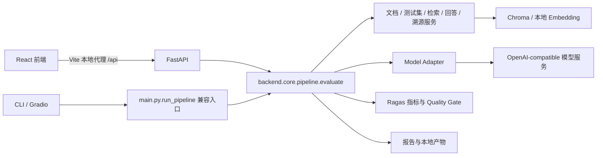

# 技术架构

阅读顺序：前端提交评测参数 → API 校验项目内路径并串行执行 → 流水线准备文档和测试集 → 对配置模型检索、回答和评测 → 聚合门禁与报告 → 前端展示已有结果。

| 层 | 位置 | 职责 |
|---|---|---|
| Frontend | `frontend/src/` | 比赛首页、总览、工作区、对比、幻觉分析与报告预览；React、TypeScript、Vite、ECharts、原生 CSS |
| Backend API | `backend/api/` | FastAPI 请求合同、路径校验、同步调用和结果序列化 |
| Evaluation Pipeline | `backend/core/` | 评测流程编排、结果聚合、质量门禁；保留既有指标与判定口径 |
| Services | `backend/services/` | 文档处理、正负样本、检索、回答和逐句溯源 |
| Model Adapter | `backend/adapters/models/` | 模型注册和 OpenAI-compatible 客户端；从环境变量读取凭据 |
| Reporting | `backend/reporting/` | HTML、Excel、PDF、评测图表等已有报告能力 |
| Storage | `backend/storage/` | 本地结果、历史与产物管理 |
| Compatibility entry | `main.py` | 当前 CLI / Gradio 经 `run_pipeline` 委托共享后端编排；`_legacy_run_pipeline` 保留旧实现供回查与回归 |

## 运行与数据语义

- 浏览器通过 Vite 的 `/api` 代理访问后端 `/health`、`/evaluate`；默认后端地址为 `127.0.0.1:8000`。
- 当前 CLI / Gradio 通过 `main.py.run_pipeline` 调用 `backend.core.pipeline.evaluate`，Web API 也调用该编排；模型工厂、参数映射和 API 校验仍有入口差异。`_legacy_run_pipeline` 不是当前 CLI / Gradio 的正常执行路径。
- `backend/adapters/ragas_compat.py` 的 `zh-sentence-v1` 仅修正 Ragas 0.1.21 的中文及中英混排陈述输入；英文路径、指标公式、权重、Trace 与门禁保持。当前共享编排的三个入口都会使用该兼容层，不修改 Ragas 全局原指标单例或 site-packages。
- 评测为同步请求，单进程内有互斥保护；使用 `--workers 1`。本版没有任务队列、取消或真实阶段进度接口。
- `/health` 仅表示服务存活，不证明密钥、模型和 Embedding 可用。
- 后端原始门禁依据第一个有效评测模型的正向忠实度和正向上下文精度，默认门槛各为 `0.8`。
- 前端当前模型结论卡展示所选模型的既有指标和可用阈值；缺失时为 WARNING，不改写后端原始门禁。PASS 不等于所有指标优秀，也不等于每条回答都正确。
- 逐句判定保留原始陈述、判断和证据；溯源需要模型调用，空记录不等于没有幻觉。
- 文档及测试集使用现有项目内路径校验；报告页仅导入本地 HTML 预览，不上传报告、不自动下载后端产物。
- 生产构建不会自动建立服务代理；快速启动针对本地展示。公网部署需独立设计鉴权、代理和资源隔离。

根目录 `.env` 只供 Python 后端使用。前端不读取模型密钥，不应将它们放入 `VITE_*` 变量。
