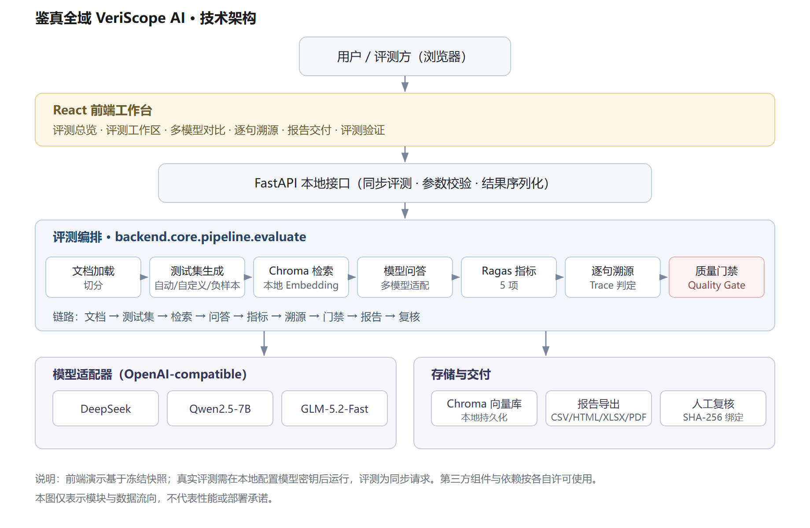

# 鉴真全域 VeriScope AI 作品介绍

> 逐句核对与质量门禁平台：AI 的每个回答，都能逐句查到出处。

材料日期：2026-10-14。证据运行：2026-10-05 正式运行，2026-10-14 修复后重跑。代码仓库：[Gitee（主）](https://gitee.com/kkbushishou/rag-hallucination-evaluator) · [GitHub（镜像）](https://github.com/4444wjt/RAG_Evaluation_Demo)。

## 一、要解决的问题

RAG 问答应用上线前，「回答是否可信」通常只看一个平均分，或者人工抽查几条。这样说不清错在哪一句，也说不清这批回答能不能放行。

本平台的做法分三步：

1. 把模型回答拆成逐句；
2. 每一句对照检索原文，核对有没有依据；
3. 由质量门禁（Quality Gate）按阈值决定这批回答能否放行。

题集、检索原文、回答、逐句判定、指标、门禁记录和人工核验保存在同一条链路上，可以逐条回查：

> 题集 → 逐句核对 → 门禁 → 报告 → 人工核验

## 二、创新点

本项目**不自研指标**，指标计算复用 Ragas，工作集中在指标之上：

| 层 | 内容 |
|---|---|
| 自研 | 逐句判定与证据定位；质量门禁（保留真实 FAIL）；人工核验存档（与机器判定并列、互不覆盖）；中文陈述兼容层 |
| 复用 | Ragas 0.1.21；LangChain、Chroma、OpenAI 兼容接口；React、ECharts；Docker Compose |

与已有方案的区别（功能定位比较，不是同条件性能排名）：

- **Ragas**：只算指标。本项目以它为指标层，在上面加逐句证据、门禁和人工核验。
- **RAGChecker**（NeurIPS 2024）：**陈述级核查上最接近的已有工作**。同样把回答拆成陈述逐条核查，分检索、生成两侧给诊断指标，并做过人工对照；每题需要参考答案，论文基准为英文。其官方仓库未描述阈值门禁或 CI 卡口；本项目把逐句核查接到发布门禁上，并审计门禁本身。
- **TruLens**：RAG 三元组（上下文相关、依据支持、回答相关），依据支持同样按陈述找证据；官方也说明结论以知识库为限。
- **Phoenix**：调用追踪、数据集与实验，评测器把 Faithfulness（对照上下文）和 Correctness（不看上下文）分开。本项目没有追踪平台，侧重发布前的门禁与证据归档。
- **DeepEval**：也能在 CI 里按阈值卡口。本项目的不同在于门禁结论旁边并列逐句证据，能回查到检索原文。
- **LLM Readiness Harness**：同样是上线前门禁。本项目进一步**检验门禁本身是否可信**。

以上比较基于各项目公开资料（核对日期 2026-10-11 至 10-14），没有做同条件对照。本项目不声称「业界唯一」，也不声称核查准确度高于上述项目。

**主要能力（均已实现）：**

1. **逐句核对与证据回查**：每句给出「有依据 / 事实错误 / 无依据编造」的判定，并和对应原文并排展示。
2. **质量门禁**：正向忠实度与正向上下文精度两个阈值（默认各 0.8）。区分正负样本，正确拒答不被当成 0 分。
3. **门禁接入 CI**：已归档的运行可以离线重放门禁，不调用模型；未通过时以非零退出码阻断构建。指定基线后逐题对比，只有「确定退步」才拦截。
4. **失败归因**：门禁拦截后，判断该修检索还是该修生成，并给出修改建议。
5. **门禁可信度审计**：检查四个问题——结论能否复算、换裁判会不会变、裁判是否依据证据、结论有多确定。详见 [门禁可信度四问](gate-credibility.md)。
6. **鲁棒性体检**：打乱、加噪、移除依据、反事实四种资料条件，检验被测应用和逐句核对是否跟着证据走。被测应用可以通过 HTTP 接口接入。详见 [鲁棒性体检](robustness/README.md)。
7. **外部基准验证**：用两个带人工标注的公开中文数据集检验逐句核对。ANAH 召回率 0.89、精确率 0.87；RGB 40 个正确回答 0 误判。详见 [外部基准验证](external-validation/README.md)。
8. **自有模型与内网部署**：任何 OpenAI 兼容接口（vLLM、Ollama、内部网关）在「模型配置」页登记即可参评，密钥只留在本机。详见 [落地与接入](../DEPLOYMENT.md)。
9. **法条结构核对**：用法规原文还原条、款、项结构，核对回答里的条号归属、数额期限与情态词；离线运行，不进入门禁口径。42 条注入陈述上规则检出 24/29（离线口径、无裁判对比）；与两个通用裁判对比时，条号类 16 条中规则检出 14 条、与 DeepSeek 持平，Qwen2.5-72B 4 条，规则零误报。详见 [法条结构核对](statute-check/README.md)。

**适用行业：** 拦的是上线前和每次改动后的版本，只查回答与资料是否一致，因此面向资料权威、答错代价高、需要留痕、要求私有化的行业。

| 场景 | 谁用 | 不拦截的后果 | 已有证据 |
|---|---|---|---|
| 银行 / 保险条款问答 | 智能客服、员工助手的测试人员；合规复核 | 限额、期限、免责条款答错，引发投诉和理赔纠纷 | 存款保险 25 题：FAIL → 归因 → 改提示词 → PASS |
| 政务咨询问答 | 政务问答、热线知识库的承建与测试团队 | 期限、材料答错，群众误期、白跑，转为投诉 | 未参与调试的政府信息公开节选：留出题 12/14 → 14/14 |
| 央国企制度问答 | 数科公司测试；合规、内审复核 | 审批权限、报销标准答错，内审查出违规 | 尚无实测 |

不适合：新闻与联网搜索（资料不保证正确）、营销与闲聊（没有对照原文）、投资建议与医疗诊断（结论不在资料里）、线上逐条实时拦截。

## 三、实际案例：发现问题 → 修复 → 验证

**1. 发现（2026-10-05）。** 用《存款保险条例》节选的 25 题正式运行（`deepseek-chat`，325 次调用）：

- 正向忠实度 **0.7375**，低于 0.8，门禁 **FAIL**，评测被拦在发布前。
- 只看 Ragas 总分是 0.59，因为 5 道正确拒答的负向题被算作 0 分；本平台分开正负样本，才得出 0.7375。

**2. 归因。** 逐句核对显示：作答题的 40 条陈述都有原文依据。拦截的 76% 来自 4 道「错误前提」题。这几道题的检索原文里有纠正所需的法条，模型却直接回答「无法回答」。结论是该修问答提示词，不是检索。

**3. 修复（2026-10-14）。** 在问答提示词里加了一句：「问题的说法或前提与参考资料不一致时，依据资料指出并纠正，不要拒答」。

**4. 验证。** 同一题集、同一资料、同一模型重跑 25 题；门禁、阈值、裁判都没有改。

- 正向忠实度 0.7375 → **0.8607**，门禁 **FAIL → PASS**。
- 4 道错误前提题纠正了 3 道，F04 仍然拒答；资料里没有答案的 5 道题仍全部正确拒答。
- 以原 FAIL 为基线逐题回归对比，未发现退步。

**5. 留出题验证。** 上一步用的是发现问题的同一批题。为检验修复能否推广，另出 24 道没参与调试的新题，作者确认后运行。两组提示只差新加的那一句：

- 错误前提题 9/14 → **14/14**：5 道由拒答改为依据资料纠正，没有一道变差。
- 正确前提题 4/5 → 5/5，资料无答案的 5 道题仍全部拒答：没有把对的改错，也没有不再拒答。

**局限：** 题量小，配对符号检验 p = 0.0625，未达到 0.05；两轮验证都只用了一个模型，各跑一次；25 题重跑离阈值只有约 0.06；**重新生成回答并换独立裁判（Qwen2.5-72B）重跑同一版本，正向忠实度 0.7992，门禁回到 FAIL；部分回答发生变化，不能把 PASS／FAIL 变化全部归因于裁判**。证据见 [正式运行](evidence/20261005T144504Z-full-39511424/README.md)、[修复验证](evidence/20261014T073859Z-full-1c6f091f/README.md)、[留出题验证](heldout-fix/20261014-deepseek/README.md)、[独立裁判复核](evidence/20261014T125415Z-full-a5002d4f/README.md)。

**外部项目（2026-10-14）。** 用同样的方法检验了 [Langchain-Chatchat](https://github.com/chatchat-space/Langchain-Chatchat) 的默认知识库提示词。5 道错误前提题中，它拒答 2 道，说明同类问题在外部项目中同样存在。只测了默认提示词，不代表其实际部署效果。已向该项目提交 Issue。详见 [外部案例](cases/langchain-chatchat/README.md)。

## 四、证据一览

| 日期 | 内容（点击查看证据） | 结果 |
|---|---|---|
| 10-05 | [25 题正式运行](evidence/20261005T144504Z-full-39511424/README.md) | 门禁 FAIL（0.7375） |
| 10-11 | [换独立裁判（Qwen2.5-72B）重判](judge-comparison/20261011-qwen72b/README.md) | 结论不变，逐题分数差异约为自我重判的 5–6 倍 |
| 10-13 | [外部基准（ANAH 300 句、RGB 100 题）](external-validation/README.md) | 召回率 0.89，精确率 0.87 |
| 10-13 | [鲁棒性体检（20 题 × 4 种条件）](robustness/README.md) | 移除依据后应用拒答 19/20 |
| 10-14 | [本机无外网试跑（Ollama 2B）](offline-run/20261014-ollama-qwen3.5-2b/README.md) | 外网连接尝试 0 次 |
| 10-14 | [修复后重跑 25 题](evidence/20261014T073859Z-full-1c6f091f/README.md) | 门禁 PASS（0.8607） |
| 10-14 | [留出题验证（24 道新题）](heldout-fix/20261014-deepseek/README.md) | 错误前提题 9/14 → 14/14，无退步 |
| 10-14 | [换独立裁判重跑修复版本](evidence/20261014T125415Z-full-a5002d4f/README.md) | 门禁 FAIL（0.7992）；回答重新生成，不能把结论变化全部归因于裁判 |
| 10-14 | [外部 RAG 端到端实测（自写示例应用）](external-rag/20261014-example-app-qwen72b/README.md) | 链路跑通，门禁 FAIL；裁判自相矛盾 |
| 10-21 | [法条注入：规则与两个通用裁判对比](statute-check/20261021-formal/README.md) | 条号类 16 条：规则 14、DeepSeek 14、Qwen2.5-72B 4；规则零误报 |

每次付费运行都经过单独授权，原始结果连同哈希一起归档，可以离线复算。

## 五、限制与诚实边界

- **裁判对照与重跑的边界**：默认由被测模型兼任裁判。10-11 换独立裁判重判，FAIL 不变；10-14 重新生成回答并换独立裁判重跑修复版本，PASS 变回 FAIL（0.7992）；部分回答发生变化，不能把结论变化全部归因于裁判。同一裁判的忠实度与逐句核对也会互相矛盾。
- **裁判误差的人工标注规模小**：3 位非作者各标完 52 条。按事先写定的两人口径分析其中两人：四类 κ 0.64，人工口径 68.8%–82.5%（裁判 73.75%），跨过门槛、6 条未决，不下结论；裁判灵敏度 95.0%、特异度 100%（6 条）。标注人的独立性只来自自述。
- **样本范围**：25 题来自同一份金融材料，不是跨领域基准，也不代表总体准确率。
- **阈值未经业务校准**：PASS 只说明样本达到设定门槛，不代表每条回答都正确。
- **三层口径，只查前两层**：引用定位（证据逐字出现在原文，代码检查）→ 语义支持（模型裁判判定，有误差）→ 事实正确（不检查）。资料本身写错时查不出；判定里的「事实错误」指与资料矛盾。
- **部署**：当前没有鉴权，评测是同步请求；公开演示站只读，不开放在线评测。

## 六、开源治理与路线图

- **许可**：自有代码 MIT；第三方依赖适用各自许可。
- **治理**：README、CONTRIBUTING、CHANGELOG、安全策略、行为准则齐备；CI、CodeQL、Scorecard 在 GitHub 镜像运行。
- **维护**：1 人（Ll）；Issue / PR 承诺 3 个工作日内首次回复。
- **未来 3 个月**（详见 [ROADMAP](../../ROADMAP.md)）：
    1. 多裁判对照，分歧的题交人工复核；
    2. 用人工标注估计裁判误差，校准门禁阈值；
    3. 评测任务队列与进度接口；
    4. 鉴权与访问隔离；
    5. 多领域基准集。

## 七、技术架构

